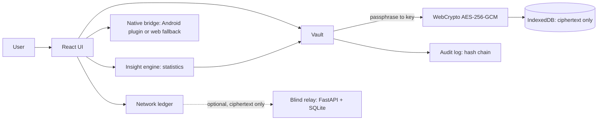
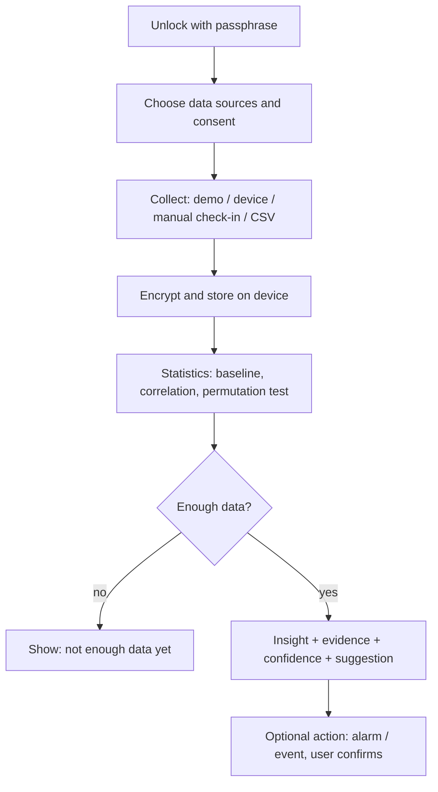

# AURA — Personal Intelligence System

> **Your data in. Insight out. Privacy always.**

**wHACKiest 2026 · Online Ideathon · Track 3 – Know Thyself: Your Data. Your Intelligence.**
**Team Phoenix · East Point College of Engineering · Team ID: e7dbcfc8**

## 1. Project Overview

AURA is a personal intelligence app that turns your own daily data (sleep, movement, screen time, food, mood) into plain-language insights about your health, habits and well-being. Your records are encrypted on your device with a key only you hold, and every network request AURA makes is shown to you. It works with airplane mode on.

## 2. Problem Statement

Smartphones, smartwatches and fitness apps generate huge amounts of personal data, but people rarely turn it into insight, and the tools that try usually ask them to hand that data over.

- Indians spend about 5 hours a day on their phones (EY, 2024).
- A BMJ analysis of 20,000+ health apps found 88% could access and potentially share personal data.

| Existing solution | Gap |
|---|---|
| Fitness tracker / wearable apps | Data is siloed per brand; shows numbers, not what they mean for you |
| Screen-time dashboards | Show hours only; never link phone use to sleep, mood or focus |
| Calorie and food loggers | Isolated from sleep and activity data; often cloud-first |
| Cloud AI health coaches | Need your raw data on their servers; little user control |

**The gap:** nobody combines your data, your own baseline, real actions and keys that only you hold.

## 3. Solution & Features

| Feature | Status in this repo |
|---|---|
| Encrypted vault (AES-256-GCM, passphrase-derived keys) | Built, tested |
| Crypto-shredding "Delete everything" | Built, tested |
| Per-source consent (turning a source off deletes its data) | Built, tested |
| Tamper-evident audit log (hash chain) | Built, tested |
| Network ledger: shows every request and bytes sent | Built |
| Insight engine: late-screen→sleep, sleep debt, "not enough data yet" states | Built, tested |
| Balance Score 0–100 with reasons | Built, tested |
| Food log: typed text → approximate calories | Built, tested |
| Ask AURA: typed alarm / calendar commands with a Confirm card | Built, tested (native side: Android plugin guide) |
| Optional blind relay (stores ciphertext only) | Built, tested |
| Real screen time from Android | Plugin code in [docs/ANDROID_PLUGIN.md](docs/ANDROID_PLUGIN.md), needs device testing |
| On-device LLM, device pairing (PAKE), redaction gateway, hardware-backed keys, leaderboard | **Roadmap only, not built** |

## 4. System Architecture / Workflow





More diagrams and UI wireframes: [docs/ARCHITECTURE.md](docs/ARCHITECTURE.md), [docs/WIREFRAMES.md](docs/WIREFRAMES.md).

## 5. Tech Stack

- **App:** React 18, Vite, TypeScript, Recharts
- **Storage and crypto:** Dexie (IndexedDB), browser WebCrypto (PBKDF2-SHA256, HKDF, AES-256-GCM)
- **Android:** Capacitor 6 shell with a small Kotlin plugin (usage access, alarm, calendar)
- **Insights:** plain statistics (median/MAD, Spearman, permutation test), no black-box model
- **Relay (optional):** FastAPI + SQLite
- **Quality:** Vitest (28 tests), pytest, GitHub Actions CI

**Planned (roadmap):** on-device LLM (WebLLM), device pairing (PAKE), Android Keystore keys, regional languages.

## 6. Team Phoenix

| Member | Role |
|---|---|
| Pushty Murarka | Team lead |
| Saathwi BK | Member |
| Priyadarshini A A | Member |
| Rounak Naskar | Member |

East Point College of Engineering, Department of Computer Science and Engineering.

---

## Run it


```bash
cd app
npm install
npm run dev          # http://localhost:5173
npm test             # 28 unit tests
npm run build
```

Optional blind relay (encrypted backup server):

```bash
cd relay
pip install -r requirements.txt
uvicorn main:app --port 8787
python -m pytest -q
```

Android (Capacitor): see [docs/ANDROID_PLUGIN.md](docs/ANDROID_PLUGIN.md).

## What is built (and tested)

| Area | What it does |
|---|---|
| Encrypted vault | PBKDF2-SHA256 (310k) → HKDF per record → AES-256-GCM, record id bound as AAD. WebCrypto only. |
| Crypto-shredding | "Delete everything" destroys salt + key check; leftover data is unreadable. |
| Consent | Per-source toggles; switching a source off deletes its records. |
| Audit log | SHA-256 hash chain; tampering is detected on verify. |
| Network ledger | Every request AURA makes goes through `ledgerFetch` and is shown with bytes sent. |
| Insight engine | Plain statistics (median/MAD, Spearman, permutation test). Late-screen→sleep and sleep-debt detectors, with "not enough data yet" states. |
| Balance score | 0–100 from sleep, movement, screen, check-in, with reasons. |
| Food log | Typed text → approximate calories from a small local table. |
| Ask AURA | Typed commands (alarm / calendar event) always shown on a Confirm card first. |
| Demo data | 30 days of synthetic data, clearly labelled DEMO everywhere. |
| Blind relay | FastAPI + SQLite storing ciphertext blobs under random mailbox IDs. |

## What is NOT built (roadmap)

On-device LLM, multi-device pairing (PAKE), redaction gateway, hardware-backed keys, leaderboards. Do not claim these in the demo. See [docs/ROADMAP.md](docs/ROADMAP.md).

## Honest claims

- Not "100% on-device" or "unhackable": data is encrypted at rest; the optional relay only receives ciphertext.
- Wellness, not medical advice. Calorie values are approximate.
- "AI" here means statistics; it says "not enough data yet" instead of guessing.

## Layout

```
app/       React + Vite + TypeScript + Capacitor
  src/lib        crypto, vault, ledger, db, relay client, demo data
  src/insights   stats, detectors, engine, balance score
  src/food, commands, native, pages, components
  tests/
relay/     FastAPI blind relay + tests
docs/      architecture, roadmap, team tasks, privacy, android plugin
```

## Docs

[Architecture](docs/ARCHITECTURE.md) · [Roadmap](docs/ROADMAP.md) · [Team tasks](docs/TEAM_TASKS.md) · [Privacy model](docs/PRIVACY.md) · [Android plugin](docs/ANDROID_PLUGIN.md)

License: MIT
