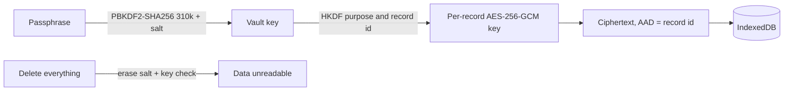
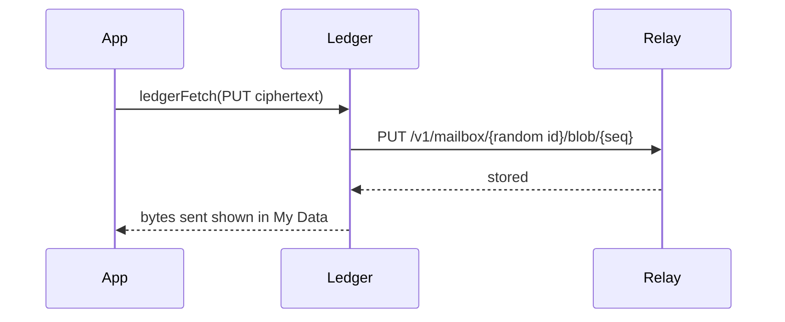

# Architecture

```
React UI ──► vault.ts ──► WebCrypto (PBKDF2 → HKDF → AES-GCM) ──► IndexedDB (Dexie): ciphertext only
   │             └─► audit log (hash chain) · consent flags (plaintext, no health data)
   ├─► insights/ (stats → detectors → engine → ranked top 3)
   ├─► native/bridge.ts ──► Capacitor plugin `AuraNative` (Android) or web fallback
   └─► lib/ledger.ts (ledgerFetch) ──► optional relay (FastAPI, ciphertext blobs)
```

Key rules
1. Plaintext health data exists only in memory while the vault is unlocked.
2. Every network call goes through `ledgerFetch` so the UI can show what left the device.
3. Insights must carry evidence (n, effect, p-value) and a confidence label; below the minimum sample they return `notEnoughData`.
4. Native actions (alarm, calendar) always require an explicit Confirm tap.

Record ids are `kind:key` (e.g. `day:2026-11-24`). The id is the AES-GCM AAD, so a ciphertext cannot be moved to another id.

## Diagrams

### Key handling



### Optional backup


